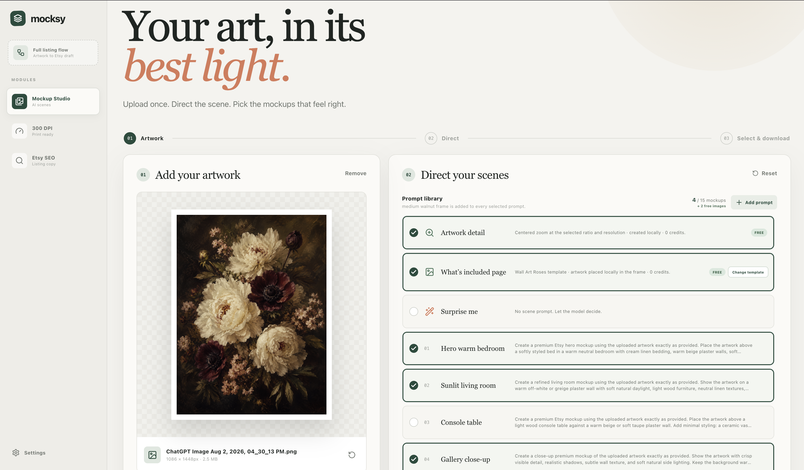

# Mocksy

A private Etsy mockup generator that places uploaded artwork into product scenes with Nano Banana or FLUX.2 Klein, with GPT-4o mini choosing one consistent frame for each batch. Nano Banana generations use Google's asynchronous Batch API for 50% lower model pricing.

## Interface



## Run locally

1. Install dependencies with `npm install`.
2. Copy `.env.example` to `.env.local` and add your private password, session secret, and the API keys you want to use.
3. Start the app with `npm run dev`.
4. Open `http://localhost:3000`.

Without an API key, the app runs in demo mode and produces lightweight preview scenes so the complete interface can still be tested. Local development uses `mocksy` as the password only when `APP_PASSWORD` is not set.

## Run with Docker

1. Copy `.env.example` to `.env` and set `APP_PASSWORD` and a random `SESSION_SECRET` of at least 32 characters. Model API keys are optional.
2. Build and start the production container:

   ```sh
   docker compose up --build -d
   ```

3. Open `http://localhost:3000` and sign in with `APP_PASSWORD`.

The container runs as a non-root user and reports its health through Docker. To use a different host port, set `MOCKSY_PORT` (for example, `MOCKSY_PORT=8080 docker compose up --build -d`). Stop it with `docker compose down`.

## Vercel environment variables

- `APP_PASSWORD`: the static password used to enter the studio.
- `SESSION_SECRET`: a long random secret used to sign sessions and encrypt saved keys.
- `GEMINI_API_KEY`: recommended for a permanent server-side Gemini connection.
- `BFL_API_KEY`: powers the stable FLUX.2 Klein 9B image-editing model.
- `OPENAI_API_KEY`: lets GPT-4o mini analyze the art and select one frame for the full batch.
- `ETSY_API_KEY`: the keystring for an Etsy Open API v3 app.
- `ETSY_SHARED_SECRET`: the Etsy app shared secret paired with the keystring.
- `ETSY_REDIRECT_URI`: required; the exact OAuth callback registered with Etsy. Prefer a public HTTPS URL, such as `https://mocksy.example.com/api/etsy/callback`.
- `ETSY_TAXONOMY_ID`: optional default Etsy seller taxonomy/category ID.

## Etsy draft publishing

1. Create or open an app in [Etsy’s developer portal](https://www.etsy.com/developers/your-apps).
2. Register the callback URL from `ETSY_REDIRECT_URI` in that app. It must match exactly, including the scheme, hostname, path, case, and trailing slash.
3. Add the Etsy keystring, shared secret, and redirect URI to `.env`, then rebuild the container.
4. Open **Settings → Etsy shop** and authorize the shop.

The final workflow review creates an inactive Etsy draft and uploads the selected listing photos in their chosen order. It never activates or publishes a listing. Digital product files can be attached later in Etsy before the draft is published.

Production access fails closed when `APP_PASSWORD` or `SESSION_SECRET` is missing. Model keys may alternatively be saved from the protected settings page; they are encrypted into an HTTP-only cookie for that browser.

## Security and public repositories

- Keep real credentials in ignored `.env` files or your deployment's secret settings. `.env.example` contains placeholders only; replace them before running a deployed instance.
- Use a unique, randomly generated `APP_PASSWORD` and a random `SESSION_SECRET` of at least 32 characters. Serve deployed instances over HTTPS and apply login rate limiting at your reverse proxy or hosting provider; the application has no built-in login rate limiter.
- `.env` variants, private key files, local Vercel settings, and the synced `sources/` reference folder are excluded from Git. These ignore rules do not remove files already committed to Git history.
- Run `npm audit --omit=dev` when updating dependencies. Commit both `package.json` and `package-lock.json`, and use `npm ci` for reproducible installs.

## Notes

- API keys are read only by server routes and are never returned to page JavaScript.
- Nano Banana Pro, Nano Banana 2, Nano Banana 2 Lite, and FLUX.2 Klein 9B can be selected per generation.
- All three Nano Banana models are submitted through the Gemini Batch API. Jobs are asynchronous, can take up to 24 hours, and are restored from browser storage after a refresh or later visit.
- The artwork is uploaded once, directly from the browser to a one-time Gemini Files API upload URL, and referenced by every request in the batch. The API key stays server-side and the full-resolution file bypasses Vercel's 4.5 MB function payload limit. Google Files are temporary (48-hour retention); the app itself does not persist uploads or generated images.
- Batch creation is never retried automatically because Google's creation endpoint is not idempotent. If the connection drops during submission, the app searches for the original display name before allowing another batch.
- Temporary status and image-download failures retry safely. Completed images are retrieved one at a time over a streamed response, and failed generations or downloads are shown without hiding successful mockups.
- GPT-4o mini selects a frame once before generation. Its exact frame direction is reused for every mockup in the batch; without an OpenAI key, the app uses a slim walnut fallback.
- Prompt changes are saved in the browser automatically.
- Uploaded artwork and generated results are not stored by this app.
- Full-flow mockup selections are stored in the browser’s IndexedDB until the Etsy draft is created or a new listing workflow is started.
